# Preference-Aware Cooperative Task Allocation and Fair Reward Sharing in Heterogeneous Multi-Agent Teams

[](https://www.python.org/)
[](#-installation--reproducibility)
[](#)
[](#)

> **Course:** CS329 Multi-Agent Systems (Foundations of AI), Semester 7, IIT Gandhinagar, Group 32
> **Team:** Prajas Kulkarni (`prajas.kulkarni@iitgn.ac.in`) · Dhairya Shah (`dhairya.shah@iitgn.ac.in`) · Goral Mashru (`goral.mashru@iitgn.ac.in`) · Yash Yeole (`yash.yeole@iitgn.ac.in`)

> [!IMPORTANT]
> **SEE THE WHOLE PIPELINE IN ONE COMMAND.** No server, no internet: it runs every solver once and opens a self-contained page in your browser.
>
> ```bash
> pip install -r requirements.txt
> python scripts/visualize_pipeline.py --agents 10 --tasks 40 --clustered --open
> ```
>
> | Step | What you see |
> | :--- | :--- |
> | 🗺️ **1. Scenario** | Heterogeneous robots (size = speed) and tasks (size = priority) on a 500 m × 500 m map |
> | 🧩 **2. Clustering** | The coalitions SVCA / GA build, the Shapley value of every robot and task, SVCA's V(C) per round |
> | 🔋 **3. Execution** | Animated playback of every route; battery rings drain and robots slow down when the battery is low |
> | 💰 **4. Reward sharing** | Preference graph, alpha slider, preference-aware vs classical Shapley vs equal split, MCMC convergence |
> | 🤝 **5. Team choice** | Robots decide whether to stay in their team or move, replayed move by move until the teams are stable |
> | 📊 **6. Compare** | Cost A(U), its breakdown, makespan and runtime of every allocation algorithm |

---

## 📑 Table of Contents

1. [Executive Summary](#-executive-summary)
2. [Interactive Viewer & Playback Modes](#-interactive-viewer--playback-modes)
3. [Simulation Environment & Coalitions](#-simulation-environment--coalitions)
4. [Animations](#-animations)
5. [Benchmark Summary](#-benchmark-summary)
6. [Mathematical Formulation](#-mathematical-formulation)
   - [Stage 1: allocation cost and SVCA](#stage-1-allocation-cost-and-svca)
   - [Stage 2: preference-aware reward sharing](#stage-2-preference-aware-reward-sharing)
   - [Stage 3: robots choose their team](#stage-3-robots-choose-their-team)
7. [Research Question, Hypotheses & Results](#-research-question-hypotheses--results)
   - [Experiment 1: allocation benchmark](#experiment-1-allocation-benchmark)
   - [Experiment 2: robots choose their team](#experiment-2-robots-choose-their-team)
   - [Experiment 3: ablation, battery-blind team value](#experiment-3-ablation-battery-blind-team-value)
8. [Project Architecture](#-project-architecture)
9. [Installation & Reproducibility](#-installation--reproducibility)
10. [Member Contributions](#-member-contributions)
11. [References](#-references)

---

## 🧭 Executive Summary

A team of heterogeneous robots (different speeds, batteries and running costs) must serve spatially
spread tasks with different priorities, and then share the reward the team earned. Two things make
this hard: centralised assignment explodes combinatorially as the fleet grows, and a naive reward
split gives robots no reason to stay in the team the planner chose for them.

We build a **three-stage pipeline**:

1. **Stage 1, allocation.** The **Shapley Value Clustering Algorithm (SVCA)** [1] ranks every robot
   and task by its Shapley value and partitions the problem into small coalitions that are solved
   separately. It is compared against Greedy insertion, two Genetic Algorithm clusterings and an
   exact MILP.
2. **Stage 2, reward sharing.** Each coalition's value is split with **cooperation preference-aware
   Shapley values** [2]: arrival orders are weighted by how much the robots like working together
   (a preference graph W), and the resulting distribution over orders is sampled with
   **Glauber dynamics MCMC**.
3. **Stage 3, robots choose their team (our extension).** Robots are not passive: under a given
   reward rule each robot compares its share in its own team with what it would earn by joining
   another team, and moves if that pays more. This turns the reward rule into something that
   **changes which robot serves which task**, and gives "coalition stability" a precise meaning
   (Nash stability of the resulting partition).

**What is new** relative to [1] and [2]: the two methods are connected in one pipeline in which the
Stage-1 coalitions define the Stage-2 reward games, and Stage 3 closes the loop by letting the reward
rule feed back into the allocation.

**Key findings** (details and caveats in [Results](#-research-question-hypotheses--results)):

<!-- KEY-FINDINGS:START -->
- **Cost-aware clustering pays off, the paper's objective does not.** Over 400 runs our cost-driven GA
  beats Greedy on 68 of 80 scenarios; paper-faithful SVCA, which optimises V(C) instead of the routing
  cost, is a median 135% more expensive and gives the least fair reward split (Gini 0.75).
- **Exact solving does not scale.** The MILP proves the optimum for 5 robots and 5 tasks in about 1 s
  (the heuristics are within 2%), but with 15 tasks it cannot improve on its warm start in 60 s.
- **Equal split is unstable.** Under equal sharing almost 2× more robots want to leave the Stage-1
  teams than under Shapley sharing (SVCA-ext teams: 27.5% vs 15.7%, GA-cost teams: 29.4% vs 16.5%).
- **Self-interested re-sorting can repair a bad clustering.** Starting from paper-SVCA's teams,
  letting robots choose under a Shapley rule cut the allocation cost by a median of 27%; 6% of these
  runs instead blow up when robots abandon a remote team.
- **Preference sensitivity alpha barely matters at the default tempering.** Alpha 0, 1.5 and 3 give
  nearly identical stability and Gini, an honest negative result for H3.
<!-- KEY-FINDINGS:END -->

---

## 🖥️ Interactive Viewer & Playback Modes

### Browser viewer (recommended)

`scripts/visualize_pipeline.py` runs every allocator, the reward solver and the team-choice dynamics
on one scenario and writes a single offline HTML page to `outputs/visualization/`.

<p align="center">
  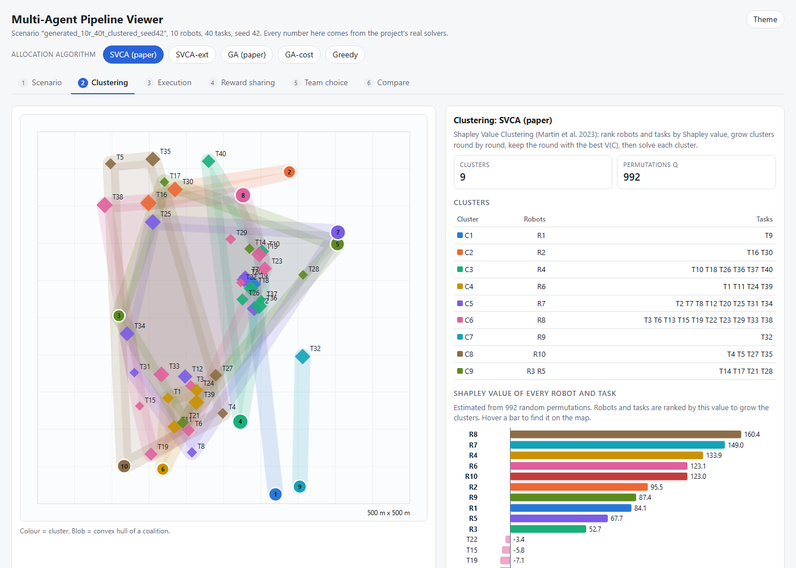
  &nbsp;&nbsp;
  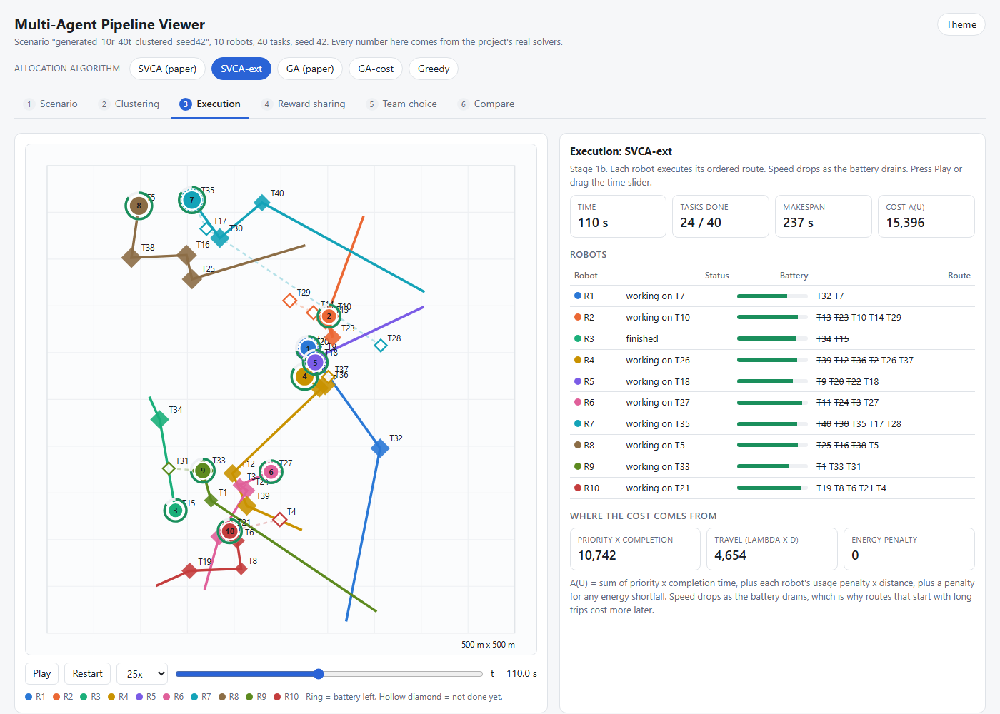
  <br>
  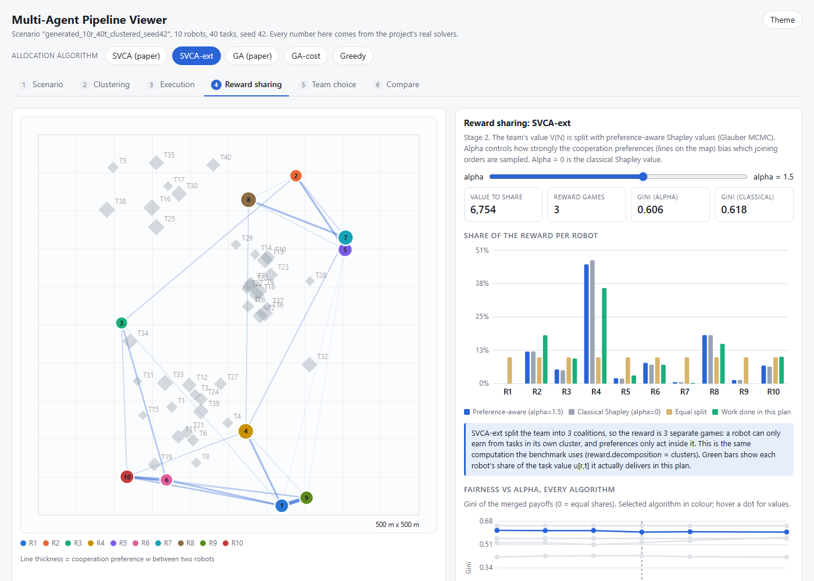
  &nbsp;&nbsp;
  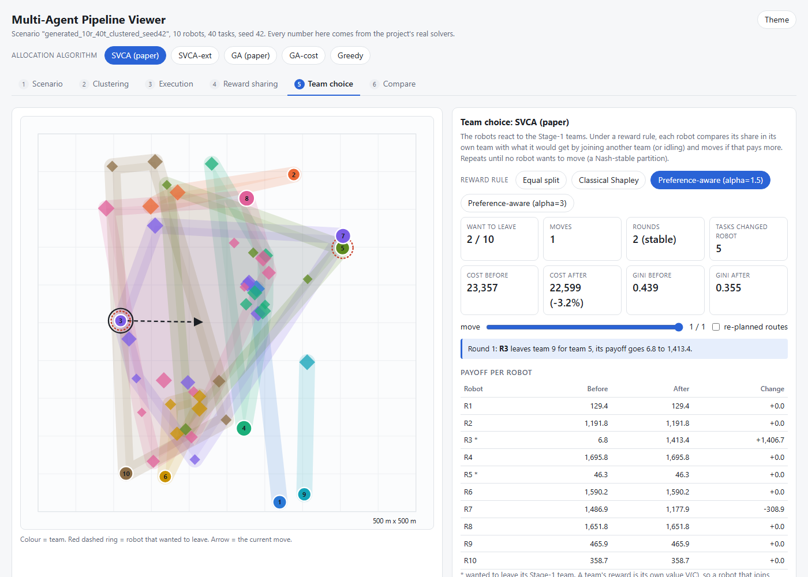
  <br>
  <em>Figure 1: The pipeline viewer. <b>Top left:</b> SVCA coalitions and Shapley ranking.
  <b>Top right:</b> animated execution with battery rings. <b>Bottom left:</b> reward split per robot
  for each rule and the Glauber MCMC convergence. <b>Bottom right:</b> a robot leaving its SVCA team
  (payoff 6.8 → 1,413), replayed move by move.</em>
</p>

- **Every number is real:** the page embeds the actual solver outputs; nothing is re-simulated in the browser.
- **The animation matches the cost exactly:** the per-leg timeline uses the same formulas as the
  evaluator that scores A(U) (a unit test checks the completion times).
- **Deep links:** `pipeline_<name>.html#step=5&algo=0` opens a given step and algorithm.
- **Options:** `--scenario <json>`, `--agents/--tasks/--clustered/--seed`, `--milp` to add the exact solver.

### Desktop playback (pygame)

```bash
python scripts/create_animation_bundle.py --scenario data/scenarios/toy_scenario.json --algorithms all --output tmp/toy.json
python scripts/play_simulation.py --bundle tmp/toy.json      # Space play/pause, Left/Right algorithm, +/- speed
```

---

## 🗺️ Simulation Environment & Coalitions

<p align="center">
  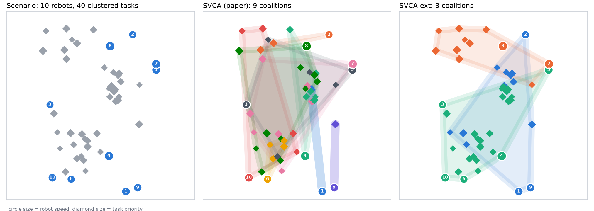
  <br>
  <em>Figure 2: <b>Left:</b> a generated scenario with 10 robots and 40 clustered tasks.
  <b>Middle:</b> paper-faithful SVCA forms 9 coalitions, several of which stretch across the map.
  <b>Right:</b> our extended SVCA forms 3 compact coalitions. Colour = coalition.</em>
</p>

**Environment characteristics** (`src/simulation/`, `src/core/`):

- **Map:** continuous 500 m × 500 m plane, Euclidean travel.
- **Robots** `x_r = (p_r, v_r, E_r, λ_r)`: speed 5 to 15 m/s, battery 500 to 2000 units,
  usage penalty λ 1 to 3 per metre, all drawn per robot (heterogeneous fleet).
- **Tasks** `y_t = (q_t, τ_t, δ_t)`: execution time 10 to 60 s, priority 1 to 5; uniform or clustered layouts.
- **Battery model:** 1 unit per metre travelled plus 0.1 unit per second of work.
- **Velocity decay:** below 15% battery a robot slows down linearly to 50% of its top speed.
- **Reproducible:** scenarios are generated from SHA-256 derived seeds, so every algorithm sees the
  identical scenario.

<p align="center">
  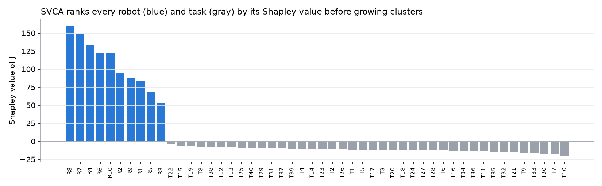
  <br>
  <em>Figure 3: SVCA's first step. Every robot (blue) and task (gray) gets a Shapley value of the
  coalition cost J; clusters are grown in this order.</em>
</p>

---

## 🎬 Animations

<p align="center">
  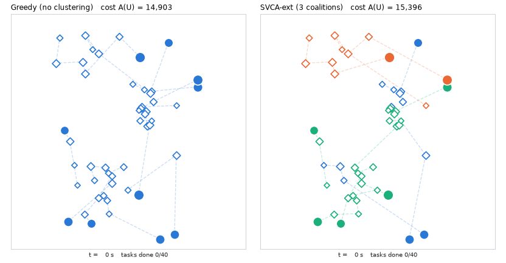
  <br>
  <em>Figure 4: The same scenario executed by Greedy (one global plan) and SVCA-ext (3 coalitions,
  colour = coalition), on one shared clock. Hollow diamonds are tasks not yet done.</em>
</p>

<p align="center">
  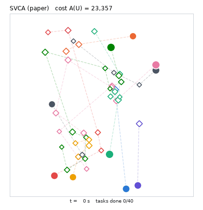
  &nbsp;&nbsp;
  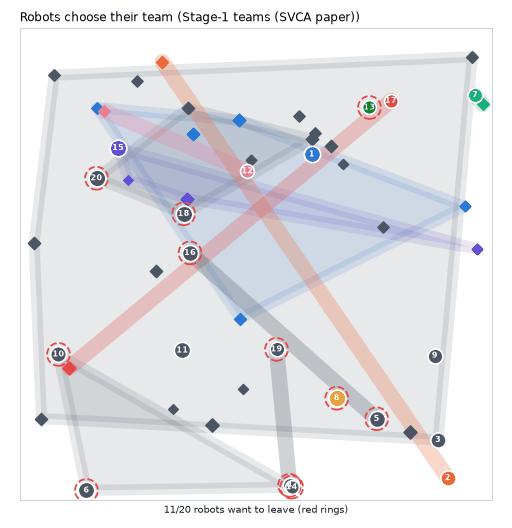
  <br>
  <em>Figure 5: <b>Left:</b> paper-faithful SVCA executing its 9-coalition plan.
  <b>Right:</b> Stage 3 on a 20-robot scenario. Red rings mark robots that want to leave their SVCA
  team; each frame is one move, until no robot wants to move (Nash stable).</em>
</p>

---

## 📊 Benchmark Summary

<!-- BENCHMARK:START -->
**400 runs:** 8 problem sizes (C1: 5 robots / 5 tasks up to C8: 35 robots / 45 tasks) × 10 random
scenarios each × 5 allocators, every allocator on the identical scenario, all 400 runs completed.
Cost A(U) is the mean ± 95% confidence interval over the 10 scenarios of a size (lower is better).

| Allocator | Cost, C2 (N=20) | Cost, C5 (N=50) | Cost, C8 (N=80) | Median vs Greedy | Beats Greedy | Battery-feasible plans | Runtime C8 (s) | Gini C8 |
| :--- | ---: | ---: | ---: | ---: | :---: | :---: | ---: | ---: |
| Greedy | 6,900 ± 421 | 8,535 ± 543 | 10,876 ± 729 | 0.0% | n/a | 100% | **0.032** | 0.39 |
| **GA-cost** (`GA`) | **6,566 ± 426** | **8,194 ± 446** | **10,616 ± 639** | **−2.9%** | **68 / 80** | 100% | 1.634 | **0.34** |
| SVCA-ext (`SVCA`) | **6,566 ± 426** | 8,510 ± 556 | 11,134 ± 805 | 0.0% | 33 / 80 | 100% | 0.213 | 0.35 |
| GA (paper) (`GA_Paper`) | 137,760 ± 113,557 | 36,967 ± 44,161 | 68,893 ± 60,756 | +68.0% | 2 / 80 | 76% | 1.243 | 0.58 |
| SVCA (paper) (`SVCA_Paper`) | 16,247 ± 10,488 | 22,727 ± 2,830 | 49,475 ± 35,663 | +135.0% | 2 / 80 | 95% | 1.010 | 0.83 |

> **Honest caveat.** The paper-faithful SVCA and GA optimise the clustering value V(C) of [1], not the
> routing cost A(U), and they do not see battery limits. That is why they produce costly and sometimes
> battery-infeasible plans here (the huge ± comes from the 1000 × shortfall penalty). Our cost-aware
> variants fix this. At C1 and C2 SVCA-ext and GA-cost form a single cluster, so they coincide.
<!-- BENCHMARK:END -->

---

## 📐 Mathematical Formulation

The definitions below are the ones implemented in the code (file references in brackets). They
also define every symbol the proposal left open.

### Stage 1: allocation cost and SVCA

Robots $\mathcal{R}$, tasks $\mathcal{T}$, entities $\mathcal{N}=\mathcal{R}\cup\mathcal{T}$, $N=R+T$.
A plan $U$ gives every robot an ordered route. The objective (`allocation/evaluator.py`) is

$$A(U)=\sum_{t\in\mathcal{T}}\delta_t\,\eta_t(U)+\sum_{r\in\mathcal{R}}\lambda_r\,d_r(U)+\varphi(U),\qquad
\varphi(U)=1000\sum_{r}\text{(energy shortfall of } r\text{)}$$

where $\eta_t$ is the completion time of task $t$ (travel at battery-dependent speed plus execution)
and $d_r$ the distance driven. Every task is assigned to exactly one robot. The benchmark scores
plans with this same $\varphi$, so the reported cost equals what every allocator optimises.

**Coalition cost** (Martin et al. [1], Eq. 5 to 7, `allocation/paper_model.py`):

$$J(S)=\psi(S)\Big(\sum_{i\in S}J_i-\alpha_1 D_{RT}(S)-\alpha_2|S|+\rho\Big)$$

- $J_i=\alpha_3E_i+\alpha_4v_i-\alpha_5\lambda_i$ for a robot and $J_i=-(\alpha_6\delta_i+\alpha_7\tau_i)$ for a task
  (attributes rescaled to the paper's ranges).
- $D_{RT}(S)$: the **average robot to task distance** inside $S$.
- $\psi(S)$: **feasibility indicator**, $1$ if $S$ contains at least one robot and one task, else $0$.
- $\rho$: a **constant that keeps $J(S)>0$** for every mixed coalition; we use the smallest provable
  bound $\rho=\sum_i\max(0,-J_i)+\alpha_1 d_{\max}+\alpha_2N+1$.
- Clustering value $V(\mathcal{C})=\Omega(\mathcal{C})\sum_h J(C_h)$, with $\Omega=0$ if a cluster has no robot.

SVCA estimates $\phi_i(\mathcal{N},J)$ from $q$ random permutations (Eq. 12), with $q$ chosen
adaptively ($q_{ini}=423$, stop when the ranking is stable), then grows clusters in Shapley order
and keeps the round with the best $V(\mathcal{C})$; each cluster is routed by greedy insertion plus
local search. The extended variant **SVCA-ext** (`allocation/svca.py`) uses a cost-aware $J$ with a
refinement pass.

### Stage 2: preference-aware reward sharing

**Team value $V$** (the reward-sharing game, `game_theory/characteristic.py`). For a team of robots
$S$ serving a task set: the *routing game* lets the robots repeatedly take the best remaining
(robot, task) pair with gain $\delta_t(H-\eta)-\lambda_r d$, respecting each robot's battery and
current clock; $V(S)$ is the total gain. The *facility game* is the fast, battery-blind variant
$V(S)=\sum_t\max_{r\in S}\max\!\big(0,\ \delta_t(H-\eta_{rt})-\lambda_r d_{rt}\big)$.

**Preference weights $W$** (`game_theory/preference.py`): $w_{mn}\in[0,1]$ combines spatial
proximity of the robots' start positions (weight 0.5), similarity of their speeds (0.3) and a
seeded random personal component (0.2), rescaled to mean $1/(N-1)$.

**Harmony and order distribution** (Xie and Lui [2]):

$$\Gamma(W_C)=\exp\Big(\textstyle\sum_{m\ne n\in C}w_{mn}\Big),\qquad
\Upsilon(\sigma)=\sum_{n=1}^{N}\Gamma\big(W_{\{\sigma_1..\sigma_n\}}\big),\qquad
\mu(\sigma)\propto e^{\alpha\Upsilon(\sigma)}$$

$$\phi_i(V)=\sum_{\sigma}\mu(\sigma)\big[V(S_i^\sigma\cup\{i\})-V(S_i^\sigma)\big]$$

$\alpha=0$ gives the classical Shapley value. Because $\Gamma$ grows like $e^{N}$, the exponent is
tempered so that $\log\Gamma(N)\le 3$ (`max_log_gamma`), otherwise $\mu$ collapses onto one order.

**Glauber dynamics** (`game_theory/mcmc.py`): swap two positions and accept with the heat-bath
probability $P(\sigma\to\tilde\sigma)=\mathrm{sigmoid}\big(\alpha(\Upsilon(\tilde\sigma)-\Upsilon(\sigma))\big)$;
estimate $\hat\phi_i=\frac1{T_w}\sum_t\Delta(\sigma^{(t)},i)$, which sums to $V(N)$ exactly.
Teams of up to 8 robots use the exact sum over all orders.

**Allocation-aware rewards:** each Stage-1 cluster is its own reward game (robots earn only from
their cluster's tasks, preferences act only inside it). Fairness is the **Gini index** of the merged payoffs.

### Stage 3: robots choose their team

Teams are defined by their tasks; robots choose which team to serve (`game_theory/team_choice.py`).
A **reward rule** maps a team to shares: *equal split* $V(C)/|C|$, *classical Shapley*
($\alpha=0$) or *preference-aware Shapley* ($\alpha>0$). In each round robots are visited in random
order; robot $i$ in team $C$ moves to team $C'$ (or idles, payoff 0) if

$$\text{share}_i(C'\cup\{i\})>\text{share}_i(C)\,(1+0.01)$$

(the 1% is a switching cost). The last robot of a team with tasks may not leave, so every task stays
covered. **Coalition stability:** a partition is **Nash stable** if no robot can raise its own
payoff by moving; we report the fraction of robots that want to leave the Stage-1 teams, the number
of moves, and whether the dynamics converge. Afterwards every team re-plans its routes with the same
sub-solver, which shows how the reward rule changed **who serves which task** and the cost A(U).

---

## 🔬 Research Question, Hypotheses & Results

> **Research question.** Can a preference-aware reward rule make the coalitions produced by SVCA
> stable, so that self-interested robots accept them, without giving up allocation efficiency?

| | Hypothesis | Verdict |
| :---: | :--- | :--- |
<!-- VERDICTS:START -->
| **H1** | Shapley-based sharing (classical or preference-aware) leaves fewer robots wanting to leave their Stage-1 team than equal split. | ✅ **Supported for cost-aware teams** (SVCA-ext 27.5% → 15.7%, GA-cost 29.4% → 16.5%); no effect on paper-SVCA teams, whose single-robot clusters make every rule identical. |
| **H2** | After robots re-sort, the allocation cost stays within a few percent of the Stage-1 plan. | ✅ **Supported**, and better: about +1% for SVCA-ext / GA-cost, and a **median −27%** for paper SVCA. ⚠️ 6% of paper-SVCA runs blow up (11% under equal split). |
| **H3** | Larger alpha yields more stable teams at the price of a higher Gini. | ❌ **Not supported** at the default tempering: alpha 0 → 3 changes the number of unhappy robots in only 8 of 72 cases and the Gini by +0.01 on average. |
<!-- VERDICTS:END -->

### Experiment 1: allocation benchmark

<!-- EXP1:START -->
**Setup.** `configs/experiments_config.yaml`: configurations C1 to C8 (N = 10 to 80 entities),
10 scenarios each, every allocator in its own worker process with a 300 s limit, reward stage
`decomposition: clusters`, α = 1.5, 1000 Glauber samples. Run with `scripts/run_benchmarks.py`.

<p align="center">
  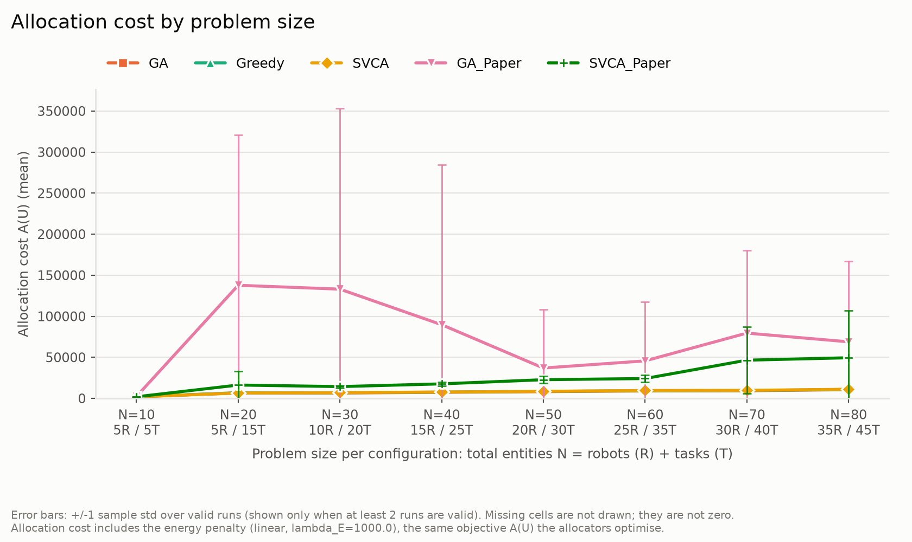
  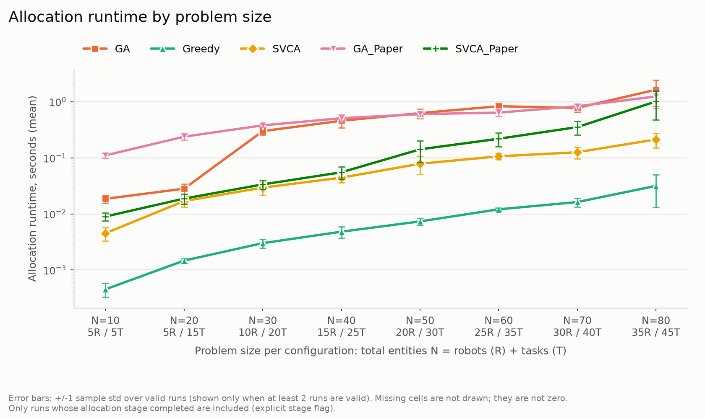
</p>

- **Cost:** GA-cost gives the cheapest plan on 68 of 80 scenarios (median 2.9% below Greedy). SVCA-ext
  ties Greedy on small problems and is about 2 to 3% above it at the largest sizes; it never fails.
- **Runtime:** every allocator stays under 2 s even at N = 80 (log scale above). Greedy is fastest by an
  order of magnitude; SVCA-ext is about 8× faster than GA-cost at C8 (0.21 s vs 1.63 s).
- **Paper-faithful methods:** paper SVCA costs a median 135% more than Greedy and paper GA 68% more,
  with frequent battery shortfalls (only 76% of paper-GA plans are feasible).

<p align="center">
  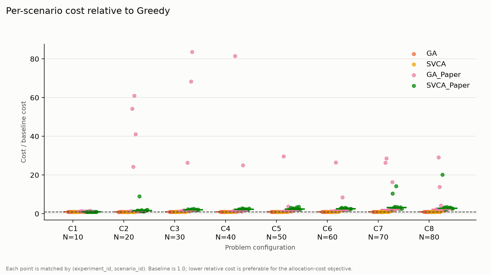
  
</p>

- **Per scenario** (left): each dot is one scenario's cost divided by Greedy's on the same scenario.
  GA-cost and SVCA-ext sit at or below 1; the paper variants scatter far above it.
- **Fairness** (right): with rewards computed per Stage-1 cluster, paper SVCA's many small clusters give
  the most unequal split (mean Gini 0.75 over all runs vs about 0.40 for the cost-aware methods).
  Robots in a cluster with no valuable task earn nothing, which is exactly what Stage 3 lets them escape.

<!-- MILP:START -->
**Exact MILP reference (C1 and C2, the same 20 scenarios, 60 s solver limit).**
Run with `scripts/run_benchmarks.py --config configs/experiments_milp_small.yaml`.

| Allocator | C1 (5 robots, 5 tasks): mean gap to the proven optimum | Matches the optimum |
| :--- | ---: | :---: |
| SVCA-ext, GA-cost, SVCA (paper) | +1.7% | 7 / 10 |
| Greedy | +2.1% | 7 / 10 |
| GA (paper) | +21.7% | 1 / 10 |

- **C1:** HiGHS solves every instance to **proven optimality** in about 1 s; the heuristics are within
  2% of the optimum on average and hit it exactly on 7 of 10 scenarios (paper GA excepted).
- **C2 (5 robots, 15 tasks):** within 60 s the MILP finds **no solution better than its Greedy + local
  search warm start** on any of the 10 scenarios, so it proves nothing. Exact centralised solving already
  stops scaling at N = 20, which is the motivation for decomposing the problem into clusters.
<!-- MILP:END -->
<!-- EXP1:END -->

### Experiment 2: robots choose their team

<!-- EXP2:START -->
**Setup.** Configurations C1 to C6 (5 to 25 robots), 3 scenarios each (the benchmark's own seeds), 4
clustering allocators × 4 reward rules = **288 runs**, battery-aware routing team value.
Run with `scripts/run_team_choice_experiment.py --only-configs C1,C2,C3,C4,C5,C6`.

<p align="center">
  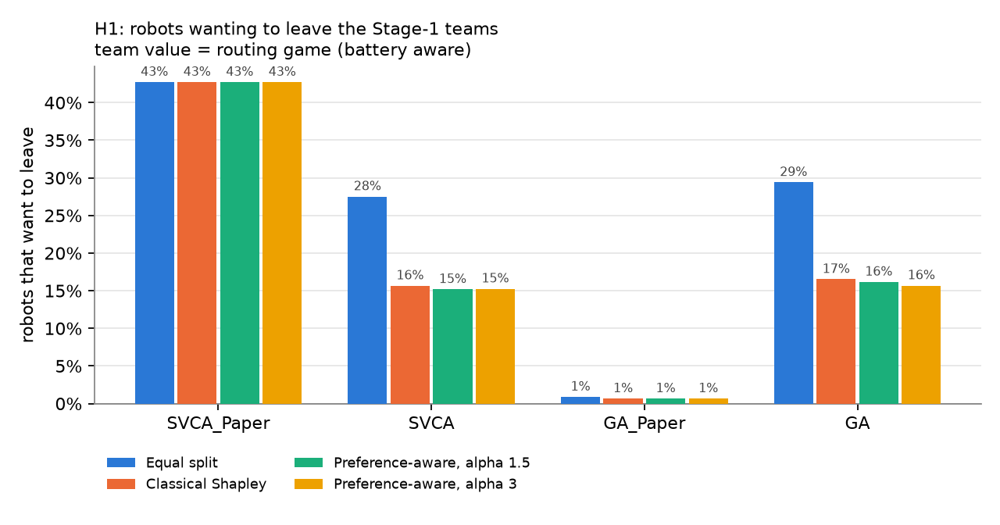
  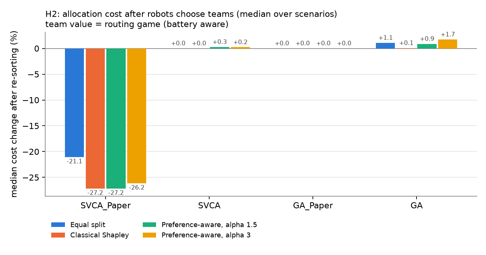
  <br>
  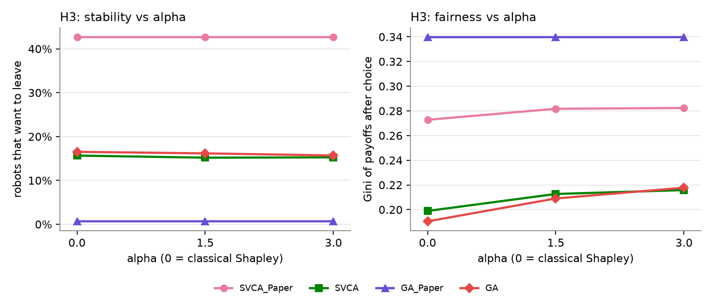
</p>

| Allocator | Reward rule | Want to leave | Median cost change | Runs > +50% | Gini before → after |
| :--- | :--- | ---: | ---: | ---: | :---: |
| SVCA-ext | Equal split | 27.5% | 0.0% | 0% | 0.04 → 0.01 |
| SVCA-ext | Classical Shapley | **15.7%** | 0.0% | 0% | 0.23 → 0.20 |
| SVCA-ext | Preference-aware, α = 1.5 | **15.2%** | +0.3% | 0% | 0.24 → 0.21 |
| GA-cost | Equal split | 29.4% | +1.1% | 0% | 0.07 → 0.01 |
| GA-cost | Classical Shapley | **16.5%** | +0.1% | 0% | 0.22 → 0.19 |
| SVCA (paper) | Equal split | 42.7% | −21.1% | 11% | 0.50 → 0.18 |
| SVCA (paper) | Classical Shapley | 42.7% | **−27.2%** | 6% | 0.57 → 0.27 |
| SVCA (paper) | Preference-aware, α = 1.5 | 42.7% | **−27.2%** | 6% | 0.58 → 0.28 |

- **Robots do reject the planner's teams.** Even under the best rule about one robot in six wants to
  move away from the cost-aware teams, and over 40% from paper-SVCA's. The dynamics reach a Nash-stable
  partition in **99.3%** of runs (2 of 288 cycled), usually within a few rounds (at most 16).
- **Contribution-based sharing is more stable than equal split** (H1): under equal split a robot that
  adds little still takes an equal cut, so productive robots leave for teams where they keep more.
- **The reward rule changes who does which task**: under the Shapley rules re-sorting moves on average
  about 6 tasks per scenario to a different robot (SVCA-ext, GA-cost) and 15 for paper SVCA, and for paper SVCA it **repairs** the clustering (median −27% cost).
  The failure mode: a few C2 scenarios (5 robots, 15 tasks) where robots desert a remote team, leaving
  one robot that runs out of battery (+485% and more), mostly under equal split.
- **Fairness:** re-sorting lowers (or keeps) the Gini in 96% of runs, because robots stuck with nothing
  valuable move to teams where they contribute.
- **Alpha (H3):** preference-aware Shapley behaves like classical Shapley. With the preference graph
  tempered to log Γ(N) ≤ 3, the order distribution μ stays close to uniform, so α has little to act on.
  A stronger preference graph is the obvious next experiment.
<!-- EXP2:END -->

### Experiment 3: ablation, battery-blind team value

<!-- EXP3:START -->
**Question.** Does the team value need to understand routes and batteries, or is the fast facility game
(each task valued independently) enough? Same setup with `--value-type facility`, on all of C1 to C8
(384 runs).

<p align="center">
  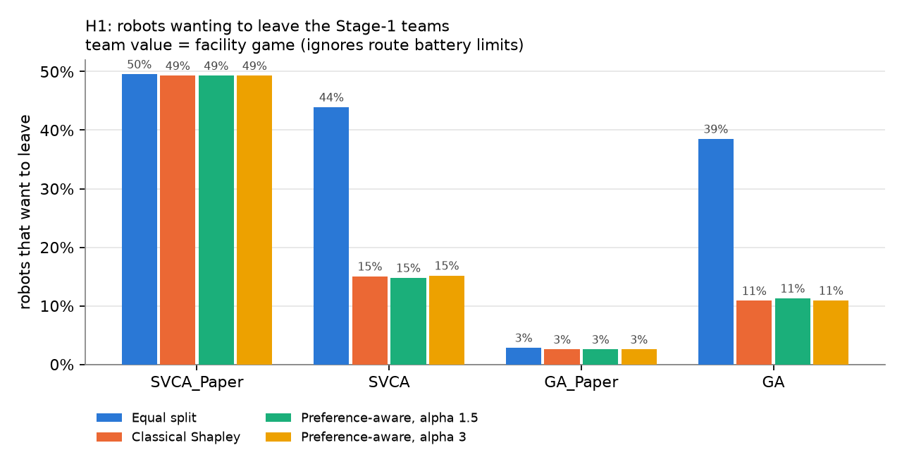
  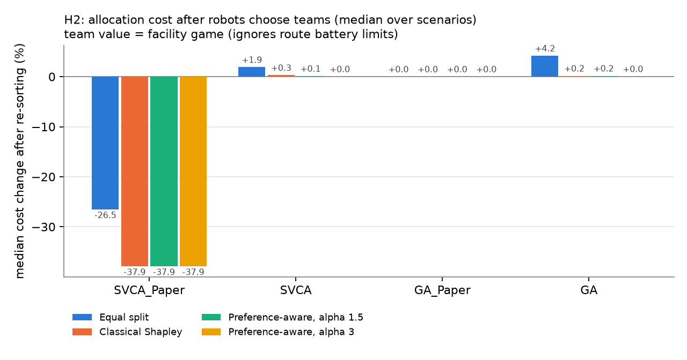
</p>

- **Same conclusions for H1 to H3.** On the matched configurations C1 to C6 both values give the same
  blow-up rate (6.9% of paper-SVCA runs) and similar medians (−22.6% facility vs −24.5% routing for paper SVCA).
- **Routing is somewhat better but much slower:** on matched paper-SVCA runs it gives the lower cost in
  37 of 72 cases (equal in 26, worse in 9), at about 11× the runtime (9.7 s vs 0.9 s per run).
- **At the largest sizes** (C7, C8) the facility value still works: Shapley-based rules had no blow-ups
  and cut paper-SVCA's cost by a median of 57%. Blow-ups are a property of individual scenarios (one
  remote team being abandoned), not of one value function.
<!-- EXP3:END -->

---

## 🏗️ Project Architecture

```text
FAI-Multi-Agent-System-Project/
├── configs/
│   ├── default_config.yaml            # SVCA-ext and MCMC defaults for demos and the viewer
│   ├── svca_paper.yaml                # paper-faithful SVCA / GA parameters (Martin et al.)
│   └── experiments_config.yaml        # benchmark: configs C1..C8, seeds, time limits, penalty, reward mode
├── src/
│   ├── core/                          # Position, Agent, Task, AllocationResult, RewardDistribution
│   ├── simulation/                    # [Prajas] generator, kinematics + battery decay, environment
│   ├── allocation/                    # [Dhairya] evaluator, Greedy, SVCA / SVCA-ext, GA / GA-cost, MILP
│   ├── game_theory/                   # [Goral] V(S) games, preference graph, Glauber MCMC, exact Shapley,
│   │   └── team_choice.py             #   clustered rewards, and Stage 3: robots choose their team
│   ├── analytics/                     # [Yash] adapters, evaluation, harness, metrics, logger, seeding,
│   │   └── team_choice_eval.py        #   and team choice -> re-plan -> metrics
│   └── visualization/                 # [Yash] plots, LaTeX tables, pygame playback,
│       └── pipeline_view.py           #   and the interactive pipeline viewer (+ pipeline_template.html)
├── scripts/
│   ├── visualize_pipeline.py          # interactive HTML view of the whole pipeline
│   ├── run_benchmarks.py              # Experiment 1 (raw CSVs in data/results/raw)
│   ├── generate_report_assets.py      # figures + tables for Experiment 1
│   ├── run_team_choice_experiment.py  # Experiments 2 and 3 (H1 to H3 figures + tables)
│   ├── make_readme_media.py           # the figures and GIFs in docs/media/
│   ├── run_allocation_demo.py, demo_reward_solver.py, generate_sample_scenario.py
│   └── create_animation_bundle.py, play_simulation.py   # pygame playback
├── tests/                             # unit tests for every module
├── data/scenarios/                    # sample scenarios (toy, clustered)
├── docs/media/                        # README figures and animations
└── outputs/                           # generated figures, tables, viewer pages (git-ignored)
```

**Algorithm names** differ between the allocation module and the benchmark:

| Allocator class | `solver_name` | Benchmark / plots | Viewer |
| :--- | :--- | :--- | :--- |
| `PaperSVCAAllocator` (Martin et al.) | `SVCA` | `SVCA_Paper` | SVCA (paper) |
| `SVCAAllocator` (extended) | `SVCA-ext` | `SVCA` | SVCA-ext |
| `PaperGAAllocator` | `GA` | `GA_Paper` | GA (paper) |
| `GAClusteringAllocator` (cost-driven) | `GA-cost` | `GA` | GA-cost |
| `GreedyAllocator` | `Greedy` | `Greedy` | Greedy |
| `MILPAllocator` (exact, opt-in) | `MILP` | `MILP` | MILP (`--milp`) |

---

## ⚙️ Installation & Reproducibility

### 1. Set up

```bash
git clone https://github.com/Prajas02/FAI-Multi-Agent-System-Project.git
cd FAI-Multi-Agent-System-Project
python -m venv venv
.\venv\Scripts\activate            # Windows
source venv/bin/activate           # Linux / macOS
pip install -r requirements.txt    # uses pygame-ce (wheels for Python 3.13+), imported as pygame
pip install -e .
```

> [!NOTE]
> **Windows PowerShell:** if `.\venv\Scripts\activate` fails with *"running scripts is disabled on this
> system"* (an execution-policy error), run this once and then activate again:
>
> ```powershell
> Set-ExecutionPolicy -Scope CurrentUser RemoteSigned
> ```
>
> In Command Prompt use `venv\Scripts\activate.bat` instead; it is not affected by this policy.

### 2. Run the tests

```bash
python -m unittest discover tests
```

> [!NOTE]
> The full suite takes about **3 to 4 minutes** and can look idle for long stretches: some tests run
> real solvers and start worker processes to check the timeout handling. That is normal, not a hang.
> Two `EOFError: Ran out of input` tracebacks may be printed along the way; they come from tests that
> deliberately kill a worker and are not failures. The run is good if it ends with `OK`.

### 3. Reproduce every result

```bash
python scripts/run_benchmarks.py --dry-run                          # show the 400-run plan
python scripts/run_benchmarks.py                                    # Experiment 1
python scripts/generate_report_assets.py                            # its figures and tables
python scripts/run_team_choice_experiment.py --only-configs C1,C2,C3,C4,C5,C6   # Experiment 2
python scripts/run_team_choice_experiment.py --value-type facility  # Experiment 3 (all C1..C8)
python scripts/make_readme_media.py                                 # README figures and GIFs
```

### 4. Team decisions encoded in `configs/experiments_config.yaml`

- **Energy penalty** `linear`, `lambda_E = 1000`: identical to the allocators' own objective.
- **Reward decomposition** `clusters`: one reward game per Stage-1 cluster (Greedy and MILP play one
  global game); `global` restores the single scenario-wide game.
- **MILP** is registered but opt-in (add `- MILP` under `benchmark.algorithms`); it is exact and slow.

### 5. Using the reward solver directly

```python
from src.simulation.generator import ScenarioGenerator
from src.game_theory import PreferenceAwareShapleySolver
from src.game_theory.team_choice import TeamChoiceConfig, choose_teams

scen = ScenarioGenerator(seed=42).generate_scenario(num_agents=20, num_tasks=30)
dist = PreferenceAwareShapleySolver.from_scenario(scen, alpha=1.5).solve("glauber")  # RewardDistribution
teams = choose_teams(scen, clusters=None, config=TeamChoiceConfig(rule="preference", alpha=1.5))
```

Work on your own branch and merge into `main` through a pull request; run the tests first.

---

## 👥 Member Contributions

| Member | Proposal responsibility | Delivered |
| :--- | :--- | :--- |
| **Prajas Kulkarni** | 2D simulation engine, scenario generator, kinematics, battery / velocity decay | ✅ `src/simulation`, `src/core`; integration and consistency fixes, Stage 3 (team choice), interactive viewer, README media |
| **Dhairya Shah** | Greedy baseline, GA clustering, SVCA partitioning | ✅ `src/allocation`: paper SVCA and GA, SVCA-ext, GA-cost, Greedy, exact MILP, shared evaluator |
| **Goral Mashru** | Characteristic functions, stratified MC, Glauber MCMC, preference-aware Shapley solver | ✅ `src/game_theory`: facility and routing games, preference graph, Glauber MCMC, exact and sampled Shapley, clustered rewards |
| **Yash Yeole** | Experiment harness, metrics (Gini, runtime, cost), plotting | ✅ `src/analytics`, `src/visualization`: benchmark harness with timeouts, seeding, logging, report figures and tables, pygame playback |

---

## 📚 References

1. J. G. Martin, F. J. Muros, J. M. Maestre, E. F. Camacho. *Multi-robot task allocation clustering based on game theory.* Robotics and Autonomous Systems, 161:104314, 2023.
2. H. Xie, J. C. S. Lui. *Cooperation preference aware Shapley value: Modeling, algorithms and applications.* IEEE/ACM Transactions on Networking, 31(6):2439 to 2453, 2023.
3. L. S. Shapley. *A value for n-person games.* Contributions to the Theory of Games II, Annals of Mathematics Studies 28, 307 to 317, 1953.
4. A. Bogomolnaia, M. O. Jackson. *The stability of hedonic coalition structures.* Games and Economic Behavior, 38(2):201 to 230, 2002.
5. J. Castro, D. Gómez, J. Tejada. *Polynomial calculation of the Shapley value based on sampling.* Computers & Operations Research, 36(5):1726 to 1730, 2009.
6. R. J. Glauber. *Time-dependent statistics of the Ising model.* Journal of Mathematical Physics, 4(2):294 to 307, 1963.
7. Q. Huangfu, J. A. J. Hall. *Parallelizing the dual revised simplex method.* Mathematical Programming Computation, 10(1):119 to 142, 2018 (HiGHS, used by the MILP baseline).
